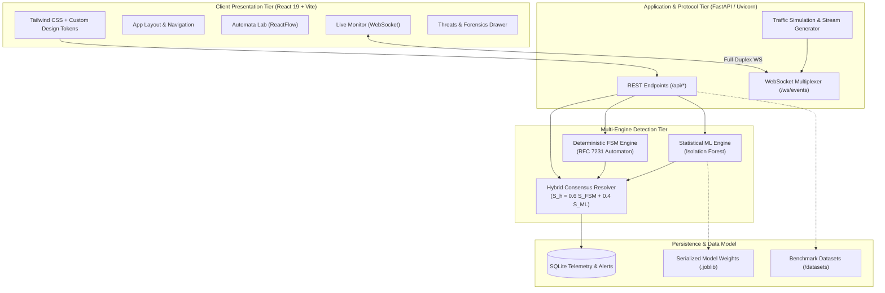

# TraceGuard AI — Formal Protocol Verification Meets Hybrid Intrusion Detection

[](#formal-theory-of-computation-model)
[-10B981.svg)](#formal-theory-of-computation-model)
[](#formal-theory-of-computation-model)
[](#formal-theory-of-computation-model)
[](https://www.python.org/)
[](https://fastapi.tiangolo.com/)
[](https://react.dev/)
[](https://vitejs.dev/)

> **Academic Project Notice:** TraceGuard AI is an educational and scientific demonstration prototype developed for an academic **Theory of Computation / Formal Languages and Automata Theory** curriculum. It bridges mathematical finite-state verification with machine-learning anomaly detection to protect stateful network protocols. It is designed for demonstration and research evaluation, not commercial perimeter defense.

---

## 1. Project Overview

Modern application protocols (e.g., HTTP/1.1, TLS, SSH) are fundamentally stateful communication systems. Traditional Network Intrusion Detection Systems (NIDS) primarily perform regex signature pattern matching or statistical anomaly classification on isolated packets. Neither paradigm mathematically evaluates whether an observed sequence of protocol operations is legal with respect to formal state machine specifications.

**TraceGuard AI** demonstrates how formal automata theory directly addresses this challenge:
1. **Deterministic Verification ($\text{Tier 1}$):** Formulates application session lifecycles as a formal Complete Deterministic Finite Automaton (Complete DFA) $\mathcal{M} = (Q, \Sigma, \delta, q_0, F)$ that decides sequence language membership in $O(1)$ time per event transition with zero false positives on conforming streams.
2. **Statistical Outlier Detection ($\text{Tier 2}$):** Deploys an unsupervised Isolation Forest model trained on 15 multivariate session features (payload byte sizes, inter-arrival latencies, cyclic counts) to detect zero-day deviations that preserve syntactic transition order.
3. **Hybrid Consensus Scoring:** Synthesizes deterministic FSM state violations and statistical anomaly probabilities into an interpretable risk index with a strict mathematical violation floor.

---

## 2. Key Features

- **Complete HTTP Finite State Machine**: Total transition coverage modeling connection handshakes, request parsing, authentication checks, status dispatches, and teardown cycles.
- **Interactive Automata Laboratory**: Web-based ReactFlow visualizer with real-time node highlighting, sequence stepping, and a complete $9 \times 13$ transition matrix.
- **Live Protocol Streaming Monitor**: Full-duplex WebSocket stream (`/ws/events`) visualizing incoming network sessions, state transitions, and live throughput gauges.
- **Forensic Threat Triage**: Multi-engine anomaly investigation console with per-session root cause explanations, transition violation histories, and operator note auditing.
- **Detection Benchmark Lab**: Multi-engine comparative evaluation against 32 standardized benchmark datasets calculating Precision, Recall, F1 Score, and False Positive Rates.
- **Dataset Registry & Corpus Management**: Ingest, catalog, and export CSV/JSON packet capture corpora.
- **Embedded Presentation Mode**: 14-slide university defense walkthrough with live automata execution directly accessible from the top navigation bar.

---

## 3. System Architecture



---

## 4. Formal Theory of Computation Model

The HTTP Protocol State Machine in TraceGuard AI is formalized as a **Complete Total Deterministic Finite Automaton (Complete DFA)**:

$$\mathcal{M} = (Q, \Sigma, \delta, q_0, F)$$

### 4.1 Formal 5-Tuple Definition

| Mathematical Tuple Element | Formal Value in TraceGuard AI | Description |
| :--- | :--- | :--- |
| **$Q$ (State Space)** | $|Q| = 9$ | $\{\text{IDLE}, \text{CONNECTED}, \text{REQUEST\_RECEIVED}, \text{AUTH\_CHECKED}, \text{AUTH\_FAILED}, \text{RESPONSE\_SENT}, \text{ERROR}, \text{CLOSED}, \text{TRAP}\}$ |
| **$\Sigma$ (Alphabet)** | $|\Sigma| = 13$ | $\{\text{CONNECT}, \text{REQUEST}, \text{AUTH\_SUCCESS}, \text{AUTH\_FAILURE}, \text{RESPONSE\_200}, \text{RESPONSE\_301}, \text{RESPONSE\_401}, \text{RESPONSE\_403}, \text{RESPONSE\_500}, \text{CLOSE}, \text{TIMEOUT}, \text{MALFORMED}, \text{ERROR\_RESPONSE}\}$ |
| **$\delta$ (Total Transition Function)** | $\delta: Q \times \Sigma \to Q$ | Complete transition matrix containing exactly $\|Q\| \times \|\Sigma\| = 9 \times 13 = \mathbf{117}$ total mapping entries |
| **$q_0$ (Start State)** | $\text{IDLE} \in Q$ | Initial quiescent state awaiting transport handshake |
| **$F$ (Accepting Set)** | $\{\text{CLOSED}\} \subset Q$ | Terminal accepting state reached upon legitimate teardown |
| **$\text{TRAP}$ (Dead Sink)** | $\text{TRAP} \notin F$ | Non-accepting, absorbing dead state ($\forall \sigma \in \Sigma, \delta(\text{TRAP}, \sigma) = \text{TRAP}$) |

### 4.2 Language Classification Semantics

TraceGuard AI rigorously distinguishes three fundamental automata outcomes for an input sequence $w = \sigma_1 \sigma_2 \dots \sigma_n$:

1. **`ACCEPTED` ($w \in L(\mathcal{M})$):**  
   Every transition is valid and the final state is in $F$ ($\delta^*(q_0, w) \in F$). Represents a completely executed, valid HTTP session terminated cleanly.
2. **`INCOMPLETE_VALID` ($w$ is a valid prefix):**  
   Every individual transition is mathematically valid, but the final state is non-accepting ($\delta^*(q_0, w) \in Q \setminus (F \cup \{\text{TRAP}\})$). Represents an in-flight, compliant session currently awaiting subsequent protocol packets. (Includes the empty string $\varepsilon$ remaining at $q_0 = \text{IDLE}$).
3. **`REJECTED` ($w \notin L(\mathcal{M})$):**  
   The sequence contains at least one illegal or out-of-order transition, causing the extended transition function to enter the non-escapable absorbing sink ($\delta^*(q_0, w) = \text{TRAP}$).

### 4.3 Hybrid Scoring Formula

The overall threat score $S_h$ synthesizes deterministic DFA invariant violations with multivariate statistical anomaly predictions:

$$S_h = (w_{\text{FSM}} \cdot S_{\text{FSM}}) + (w_{\text{ML}} \cdot S_{\text{ML}})$$
$$\text{where } w_{\text{FSM}} = 0.60, \quad w_{\text{ML}} = 0.40$$

- **Guaranteed Violation Floor**: Whenever an explicit DFA protocol violation is detected ($\text{fsm\_violation} = \text{true}$), the hybrid engine enforces a mandatory risk floor:
  $$S_h \ge 60\%$$

---

## 5. Technology Stack

Verified dependencies extracted directly from manifests (`backend/requirements.txt` and `frontend/package.json`):

### Backend & Detection Engine
- **Language**: Python 3.11+
- **API Framework**: FastAPI `0.115.6`
- **ASGI Server**: Uvicorn `0.34.0`
- **Database ORM**: SQLAlchemy `2.0.36` (SQLite / PostgreSQL)
- **Machine Learning**: Scikit-Learn `1.6.0`, NumPy `2.1.3`, Pandas `2.2.3`
- **Serialization**: Joblib `1.4.2`
- **Validation**: Pydantic `2.10.3` & Pydantic-Settings `2.7.0`
- **Testing**: Pytest `9.1.1`

### Frontend Application
- **Runtime**: Node.js 20+ & npm
- **Framework**: React `19.3.1`
- **Build Tool**: Vite `8.3.8`
- **Routing**: React Router DOM `7.18.5`
- **State Machine Graph**: ReactFlow `11.11.4`
- **Data Visualizations**: Recharts `3.10.1`
- **Styling**: Tailwind CSS `4.3.5` + CSS Design Tokens (`--tg-*`)
- **Iconography**: Lucide React `1.72.0`

---

## 6. Repository Structure

```
C:\Projects\FSM-NIDS\
├── backend/                         # FastAPI backend service
│   ├── alembic/                     # Database migration definitions
│   ├── app/
│   │   ├── api/                     # REST routes (alerts, dashboard, detection, etc.)
│   │   ├── core/                    # Security, database configuration, telemetry
│   │   ├── detection/               # Detection engines:
│   │   │   ├── fsm/                 # Deterministic DFA engine & 117 transition map
│   │   │   ├── ml/                  # Isolation Forest feature extractor & model
│   │   │   └── hybrid/              # Consensus resolver & scoring formula
│   │   ├── models/                  # SQLAlchemy ORM entity models
│   │   └── simulation/              # Real-time traffic & attack generator
│   ├── tests/                       # Complete pytest suite (32 tests)
│   ├── requirements.txt             # Locked Python backend dependencies
│   └── train_model.py               # ML Isolation Forest training pipeline
├── frontend/                        # React 19 single-page application
│   ├── src/
│   │   ├── components/              # UI components (KPICard, EventTable, PresentationMode)
│   │   ├── layouts/                 # AppLayout sidebar and header
│   │   ├── pages/                   # 7 Core views (Dashboard, AutomataLab, Threats, etc.)
│   │   ├── services/                # API client (Fetch) and WebSocket manager
│   │   └── styles/                  # Tailwind CSS and design-system.css tokens
│   ├── package.json                 # Node dependencies and build scripts
│   └── vite.config.js               # Vite build configuration
├── datasets/                        # Standard benchmark CSV packet captures
├── docs/                            # Comprehensive academic & technical documentation
├── models/                          # Pre-trained Isolation Forest weights (.joblib)
├── presentation/                    # University defense presentation (.pptx)
├── scripts/                         # Synthetic dataset generation & audit utilities
├── submission/                      # Packaging verification reports & submission ZIP
├── .dockerignore                    # Container build exclusions
├── .env.example                     # Safe environment template without secrets
├── .gitignore                       # Repository exclusion rules
├── Dockerfile                       # Production multi-stage Docker container
└── docker-compose.yml               # Multi-container orchestration file
```

---

## 7. Installation & Local Execution

### 7.1 Prerequisites
- **Python**: Version `3.11` or higher
- **Node.js**: Version `20` or higher (with `npm`)
- **Shell**: Windows PowerShell (or standard Bash)

### 7.2 Backend Setup
```powershell
# Navigate to backend directory
cd C:\Projects\FSM-NIDS\backend

# Install Python dependencies
pip install -r requirements.txt

# Set PYTHONPATH to the backend folder
$env:PYTHONPATH="C:\Projects\FSM-NIDS\backend"

# Launch FastAPI server
python -m uvicorn app.main:app --host 0.0.0.0 --port 8000 --reload
```
*Backend API documentation available at `http://localhost:8000/docs`.*

### 7.3 Frontend Setup
```powershell
# Open a new terminal and navigate to frontend
cd C:\Projects\FSM-NIDS\frontend

# Install dependencies
npm install

# Start development server
npm run dev
```
*Frontend interface accessible at `http://localhost:5173/`.*

### 7.4 Running Automated Tests
```powershell
cd C:\Projects\FSM-NIDS
$env:PYTHONPATH="C:\Projects\FSM-NIDS\backend"

# Run all automated test suites
python -m pytest backend/tests/ -v
```

---

## 8. Academic Documentation Directory

Detailed theoretical proofs and reports are available in the [`docs/`](docs/) directory:

- [FORMAL_AUTOMATON.md](docs/FORMAL_AUTOMATON.md) — Mathematical specification of $\mathcal{M} = (Q, \Sigma, \delta, q_0, F)$ and completeness theorems.
- [TRANSITION_TABLE.md](docs/TRANSITION_TABLE.md) — Exhaustive 117-cell deterministic transition matrix.
- [TOC_THEORY.md](docs/TOC_THEORY.md) — Foundations: Regular languages, Chomsky hierarchy, and pumping lemma considerations.
- [ALGORITHM_EXPLANATION.md](docs/ALGORITHM_EXPLANATION.md) — In-depth breakdown of FSM verification, Isolation Forest ML, and consensus logic.
- [PROJECT_REPORT.md](docs/PROJECT_REPORT.md) — University project report with problem statement, methodology, and results.
- [VIVA_PREPARATION.md](docs/VIVA_PREPARATION.md) — 60 viva voce defense questions, mathematical derivations, and counterarguments.
- [FINAL_PRESENTATION_SCRIPT.md](docs/FINAL_PRESENTATION_SCRIPT.md) — Timed defense presentation script coordinated with slides.
- [PHASE_9_FINAL_QA_REPORT.md](docs/PHASE_9_FINAL_QA_REPORT.md) — Full independent QA, route verification, and functional test report.
- [UI_REDESIGN_REPORT.md](docs/UI_REDESIGN_REPORT.md) — Architectural design system overhaul and visual hierarchy specification.

---

## 9. Academic Limitations

In the interest of scientific integrity, the following limitations are documented:
1. **Regular Language Expressive Boundary**: Deterministic Finite Automata recognize strictly Type-3 Regular Languages. They cannot validate arbitrarily nested recursive syntax (e.g., deeply nested JSON or chunked HTTP payloads), which require Pushdown Automata (Context-Free Grammars).
2. **Synthetic Telemetry**: The evaluation datasets were generated using synthetic packet captures conforming to RFC 7231 specifications with injected protocol faults. While effective for proof-of-concept verification, performance on live multi-gigabit enterprise backbones will encounter packet fragmentation and TCP out-of-order reassembly challenges.
3. **Session Abstraction**: Verification occurs on parsed protocol event sequences rather than raw network Ethernet frame buffers.

---

## 10. Authors & Course Information

- **Course**: Theory of Computation / Formal Languages and Automata Theory
- **Department**: Computer Science & Engineering
- **Project Name**: TraceGuard AI: Protocol NIDS
- **Academic Year**: 2026
