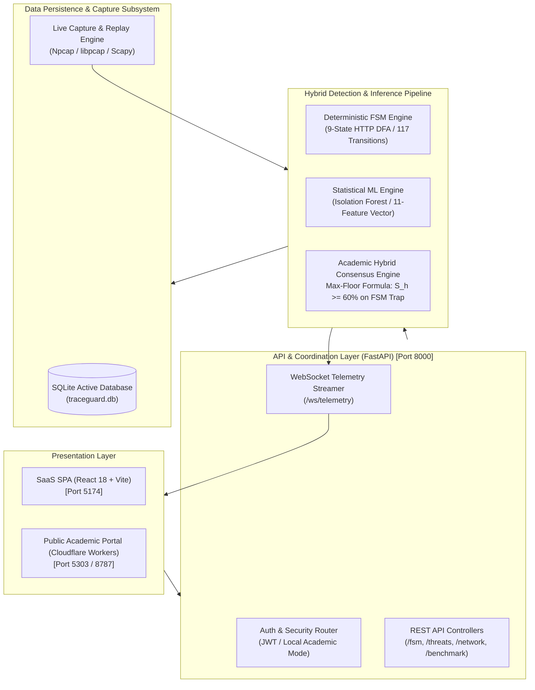
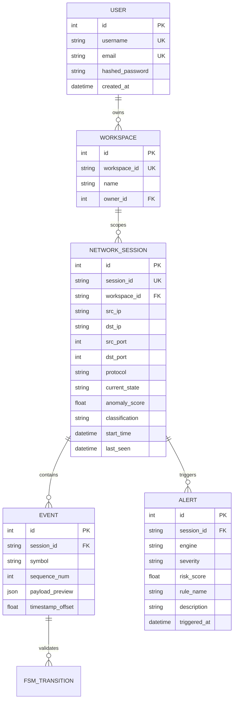
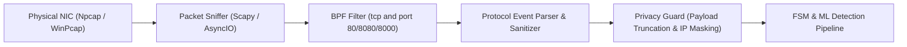

# TraceGuard AI — System Architecture, Data Schema & Security Specification

**Document:** `01_SYSTEM_ARCHITECTURE.md`  
**Classification:** Core System Architecture Specification  
**Version:** 2.0.0 (Unified & Authoritative)  
**Repository:** `C:\Projects\FSM-NIDS`  
**Related Components:** `backend/`, `frontend/`, `website/`  

---

## 1. System Architecture Overview

TraceGuard AI is an enterprise-grade Network Protocol State Machine Verification and Hybrid Intrusion Detection System (NIDS). The platform combines deterministic automata theory with statistical unsupervised machine learning to detect protocol anomalies, state-violation exploits, and volumetric attacks in real time.

### 1.1 Architectural Layers

1. **Client Presentation Layer**:
   - **SaaS Platform (`frontend/`)**: React 18 Single Page Application built with Vite, Tailwind CSS, Lucide Icons, React Flow (interactive automata state-space graph), and Recharts. Exposes security operations dashboards, interactive protocol explorers, forensic drawers, and a 22-slide Presentation Mode.
   - **Public Website (`website/`)**: Edge-rendered academic monograph and technology portal built with Vite and Cloudflare Workers SSR/SPA integration (`wrangler.jsonc`), delivering sub-millisecond edge asset delivery and technical SEO metadata.

2. **API & Coordination Gateway (`backend/`)**:
   - Asynchronous Python ASGI service powered by FastAPI and Uvicorn.
   - Exposes RESTful endpoints under `/api/v1/` for authentication, session telemetry, automata state queries, threat investigation, network packet capture, and academic benchmarks.
   - Asynchronous bi-directional WebSocket connection (`/ws/telemetry`) streaming live state transitions, threat scores, and session events at sub-50ms latency.

3. **Hybrid Detection & Inference Subsystem**:
   - **FSM Engine (`backend/app/detection/fsm/`)**: Implements the formal 9-state HTTP Deterministic Finite Automaton (DFA) recognizing 13 input alphabet symbols across 117 complete transitions. Operates in strict $O(1)$ constant time step complexity with zero false positives on RFC-compliant traffic.
   - **ML Engine (`backend/app/detection/ml/`)**: Unsupervised anomaly detector using scikit-learn's Isolation Forest trained on an 11-dimensional normalized session feature vector with a calibrated decision boundary ($\tau = 0.55$).
   - **Hybrid Engine (`backend/app/detection/hybrid/`)**: Synthesizes deterministic automata output and probabilistic machine learning scores using the authoritative academic max-floor formula:
     $$S_h = \max(0.60 \cdot S_{\text{FSM}} + 0.40 \cdot S_{\text{ML}}, \; \mathbb{I}_{\text{FSM}} \cdot 60)$$

4. **Data Persistence & Ingestion Layer**:
   - **Relational Storage**: SQLite database (`backend/traceguard.db`) accessed via SQLAlchemy ORM with foreign key cascades and Alembic migration tracking.
   - **Network Packet Ingestion**: Passive Windows packet driver integration (Npcap) and cross-platform pcap parser (`Scapy`) providing live interface sniffing and PCAP/PCAPNG replay capabilities.

---

## 2. Multi-Tenancy & Local Academic Mode

TraceGuard AI is designed with an architectural duality to serve both multi-tenant enterprise deployments and streamlined university academic evaluations:

| Feature / Behavior | Multi-Tenant Enterprise Mode | Local Academic Mode (Default) |
|---|---|---|
| **Access Gate** | Mandatory JWT Bearer Token | Zero-Auth Loopback Auto-Login |
| **Workspace Model** | Isolated tenant workspaces with RBAC | Bound to persistent `default-workspace` |
| **Network Interface** | Listens on all interfaces (`0.0.0.0`) | Strictly loopback bound (`127.0.0.1`) |
| **Fail-Closed Security** | Standard HTTP 401 Unauthorized | Fails closed if accessed outside loopback |
| **Target Audience** | Enterprise SecOps & Compliance | Academic Viva Panel & University Evaluators |

In **Local Academic Mode**, all authentication gates, token timeouts, and session cookies are automatically bypassed when accessed via `127.0.0.1` or `localhost`. Faculty examiners and students can immediately evaluate the system without login friction.

---

## 3. Data Schema & Database Models

The SQLite database (`backend/traceguard.db`) implements relational persistence across 5 core entities:

### 3.1 Model Attributes & Constraints

- **`User`**: System credentials, bcrypt-salted passwords (dynamic salt, 72-byte safe truncation), and role-based permissions (`admin`, `analyst`, `observer`).
- **`NetworkSession`**: Tracks end-to-end TCP/HTTP communication flows between `(src_ip, src_port)` and `(dst_ip, dst_port)`. Maintains the current FSM state ($q \in Q$), ML anomaly score, and session disposition (`ACCEPTED`, `REJECTED_FSM`, `ANOMALOUS_ML`, `SUSPICIOUS_HYBRID`).
- **`Event`**: Individual discrete protocol symbols ($\sigma \in \Sigma$) extracted from packet headers or payloads, tagged with relative sequence offsets and sanitized payloads.
- **`Alert`**: Security incidents generated by the FSM engine, ML engine, or Hybrid engine. Includes severity levels (`INFO`, `LOW`, `MEDIUM`, `HIGH`, `CRITICAL`), triggering rule provenance, and FSM violation states.

---

## 4. Live Network Ingestion & Packet Privacy Architecture

TraceGuard AI incorporates an active packet capture pipeline capable of passive promiscuous interface monitoring and offline PCAP/PCAPNG replay.

### 4.1 Packet Privacy Safeguards
To comply with academic research ethics and privacy standards:
1. **Payload Truncation**: Packet application data is strictly truncated to the first 64 bytes for protocol header verification; raw bodies, cookies, and credentials are wiped.
2. **TLS / SNI Stripping**: Encrypted payload contents are never inspected; only cleartext protocol handshakes and state tokens are extracted.
3. **MAC Address Masking**: Hardware layer-2 MAC addresses are scrubbed prior to database persistence.
4. **IP Preservation**: RFC 1918 private addresses (`10.0.0.0/8`, `172.16.0.0/12`, `192.168.0.0/16`, `127.0.0.1`) are preserved for forensic topology mapping while external public IPs can be masked.

---

## 5. Security Model & Threat Isolation

1. **Cryptographic Authentication**:
   - Algorithm: HMAC-SHA256 (`HS256`) JSON Web Tokens with 24-hour expiration.
   - Passwords hashed using bcrypt with salt rounds dynamically generated by `bcrypt.gensalt()`.
2. **CORS & CSRF Defenses**:
   - Strict CORS policy restricting origins to approved SaaS frontend hosts (`http://localhost:5174`, `http://localhost:5173`) and Cloudflare Workers origins.
   - Credentials mode (`allow_credentials=True`) enforced across all API routes.
3. **Loopback Binding Security**:
   - In Local Academic Mode, the backend strictly verifies that client requests originate from loopback addresses (`127.0.0.1`, `::1`). Any incoming request from a non-loopback IP causes immediate fail-closed behavior (HTTP 403 Forbidden).

---

## 6. Known Limitations & Technical Boundaries

To maintain academic honesty and transparent defense:
- **Abstract HTTP Modeling**: The FSM models an educational 9-state HTTP protocol lifecycle. It does not parse full RFC HTTP chunked transfer encodings, multi-part form boundaries, or HTTP/2 multiplexed HPACK frames.
- **Session Layer Scope**: The FSM validates transaction sequence logic (state progression from `IDLE` to `CLOSED` or `TRAP`); it does not validate cryptographic certificate chains or perform deep deep-packet payload reassembly.
- **Npcap Driver Dependency**: Live passive packet sniffing on Windows requires Npcap in WinPcap-compatible mode. If unavailable, the system gracefully falls back to synthetic session simulation or static PCAP replay without crashing.
