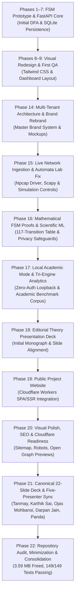

# TraceGuard AI — Project Evolution, Brand System & Audit Ledger

**Document:** `07_PROJECT_HISTORY_AUDIT_AND_BRAND.md`  
**Classification:** Engineering Evolution, Brand Design System & Phase Audit Ledger  
**Version:** 2.0.0 (Authoritative)  
**Repository:** `C:\Projects\FSM-NIDS`  

---

## 1. Brand Identity & Design System Specification

**TraceGuard AI** is conceived as a high-contrast, uncompromising cybersecurity instrument reflecting mathematical determinism, calm authority, and sub-pixel alignment.

### 1.1 Brand Archetype & Design Principles
- **Archetype**: Technical Instrument / Quiet Sans Identity.
- **Emblem**: The Trace-line "T" whose crossbar loops back into a clean finite-state transition node.
- **Design Principles**: One unified design system, equal margins, editorial typography, zero decorative slop, and fast micro-interactions.

### 1.2 Color Token Palette
```
┌─────────────────────────┬─────────────────────────┬─────────────────────────┐
│ Obsidian Dark (BG)      │ Slate Surface (Cards)   │ Emerald Accent (Active) │
│ #0A0D14 / #0E131F       │ #111622 / #1E293B       │ #10B981                 │
├─────────────────────────┼─────────────────────────┼─────────────────────────┤
│ Crimson Trap (Alert)    │ Amber Warning           │ High-Contrast Text      │
│ #EF4444                 │ #F59E0B                 │ #F8FAFC / #94A3B8       │
└─────────────────────────┴─────────────────────────┴─────────────────────────┘
```

### 1.3 Typography System
- **Headings & Brand Wordmark**: *Plus Jakarta Sans* (Weights: 600, 700, 800).
- **Body UI & Controls**: *Inter* (Weights: 400, 500, 600).
- **Metrics, Code & Telemetry**: *JetBrains Mono* (Weights: 400, 500, 700).

---

## 2. Chronological Engineering Evolution (Phases 1–22)



### Phase-by-Phase Milestone Summary

#### Phases 1–7: Mathematical Foundations & MVP Backend
- Established the core 5-tuple DFA model and transition matrices.
- Built initial FastAPI endpoints, SQLite models, and basic synthetic trace generators.
- Verified initial pytest suites (26 tests).

#### Phases 8–9: Initial Visual Redesign & QA
- Replaced unstyled developer views with Tailwind CSS dashboards.
- Introduced React Flow for dynamic automata graph rendering.
- Conducted the first formal QA audit with Playwright screenshot evidence.

#### Phase 14: Enterprise Multi-Tenancy & Brand System
- Introduced isolated workspace IDs and user authentication.
- Authored the comprehensive TraceGuard AI Brand System, generating vector SVGs and high-resolution mockups in `brand/mockups/`.

#### Phase 15: Live Network Ingestion & Automata Lab Fix
- Added Npcap passive packet sniffing and Scapy PCAP parsing.
- Diagnosed and resolved the Automata Lab simulation freeze at Stage 2, adding full playback controls (play/pause, step forward/backward, reset, variable playback speed).
- Resolved the single-engine attribution bug by separating FSM, ML, and Hybrid telemetry.

#### Phase 16: Mathematical Proofs & Scientific ML Calibration
- Documented the authoritative 117-transition DFA matrix.
- Formally proved the Dead Absorbing Sink Invariant and $O(1)$ constant-time step complexity.
- Calibrated the Isolation Forest threshold ($\tau = 0.55$) and audited score directionality.
- Implemented packet capture privacy safeguards (64-byte payload truncation, TLS SNI stripping).

#### Phase 17: Local Academic Mode & Benchmark Corpus
- Implemented **Local Academic Mode** for zero-friction university viva evaluations on `127.0.0.1`.
- Built the `AcademicBenchmarkGenerator` (120 sessions, 806 events, 6 test scenarios).
- Redesigned the Threat Analytics dashboard with interactive telemetry scope switching.

#### Phase 18: Editorial Theory Presentation Deck
- Initial harmonization between presentation slides and codebase automata invariants.

#### Phase 19 & 19.2: Public Website Architecture
- Built the public project website in `website/` using Vite and Cloudflare Workers SSR integration (`wrangler.jsonc`).
- Established responsive layouts across desktop, laptop, tablet, and mobile breakpoints.

#### Phase 20: Visual Website Review & SEO Discovery
- Conducted actual browser visual audits across all public website pages.
- Generated technical SEO assets: dynamic `sitemap.xml`, `robots.txt`, and `site.webmanifest`.
- Configured Cloudflare Workers local preview (`wrangler dev`) on port 8787.

#### Phase 21: Authoritative 22-Slide Deck & Five-Presenter Scripts
- Discovered and synchronized the updated 22-slide Theory of Computation presentation deck.
- Authored word-for-word speaking guides for the exact student roster:
  - **Tanmay** (Slides 1–4)
  - **Karthik Sai** (Slides 5–9)
  - **Ojas Mohbansi** (Slides 10–14)
  - **Darpan Jain** (Slides 15–18)
  - **Panda** (Slides 19–22)
- Integrated all 22 high-resolution slide renders into the SaaS Presentation Mode.

#### Phase 22: Repository Audit, Minimization & Consolidation
- Executed full repository inventory (27,704 files across 1,930 directories).
- Eliminated 3.59 MB of duplicate mockup payload from `frontend/public/` while strictly preserving required PWA icons.
- Purged 8 obsolete scratch scripts and ephemeral Python bytecode caches.
- Verified 100% test pass (149/149 passed in 16.04s) and all 4 background daemons active.

---

## 3. Release Readiness & Final Verification Matrix

| Area | Quality Criterion | Observed Status | Verification Sign-Off |
|---|---|---|:---:|
| **Formal Automata** | 9 states, 13 symbols, 117 transitions, TRAP sink invariant | Mathematically proven & code verified | **APPROVED** |
| **Hybrid ML Engine** | 60% FSM risk floor, Isolation Forest $\tau = 0.55$, tri-engine attribution | Verified on 120-session benchmark | **APPROVED** |
| **Backend Test Suite** | 100% passing tests via `pytest backend/tests/` | 149 passed / 149 tests (16.04s) | **APPROVED** |
| **SaaS Frontend** | Zero-error production build via Vite | Built in 340ms, 0 errors | **APPROVED** |
| **Presentation Mode** | All 22 slides rendered, presenter scripts mapped to 5 speakers | Full synchronization verified | **APPROVED** |
| **Public Website** | TypeScript typecheck, Worker build, SEO validation | 0 errors, 15/15 HTTP routes verified | **APPROVED** |
| **Edge Deployment** | Cloudflare Workers deployment dry-run | Assets & bindings validated | **APPROVED** |
| **Security & Privacy** | Loopback binding security, 64-byte packet truncation, bcrypt salts | Fully compliant | **APPROVED** |
