# TraceGuard AI — Brand Rebrand & Frontend UI Audit

**Document Version:** 1.0.0  
**Audit Date:** 2026-11-17  
**Auditor:** Agent Auditor (Swarm Agent)  
**Status:** Complete  
**Deliverable Target:** `docs/BRAND_REBRAND_AUDIT.md`

---

## 1. Executive Summary

TraceGuard AI is undergoing a comprehensive brand evolution from an initial prototype cybersecurity interface to an enterprise-grade network security platform specializing in **Network protocol state machine verification and hybrid intrusion detection**.

This audit mathematically and visually catalogues:
1. **The Official Brand Kit Assets** located in `brand/` (Recraft AI brand specification, design tokens, logo variants, raster exports, and real-world device mockups).
2. **Complete Frontend Route & Component Inventory** across `frontend/src/`.
3. **Leftover Visual Debt & Outdated Palette Inconsistencies** (including legacy background `#080B12`, legacy teal/cyan `#42D6B2`, Tailwind `cyan-*` / `slate-*` drifts, unintegrated old pages, and uncalibrated glow effects).
4. **Logo & Asset Mapping Analysis** (identifying missing SVG/PNG logo deployments in `frontend/public/` and `frontend/src/assets/`, generic Lucide icons currently standing in for the official brand mark, and browser tab / favicon discrepancies).
5. **A Prioritized Action Matrix** for downstream implementation agents (`designer`, `engineer`, `qa`).

---

## 2. Official Brand Kit Specification (`brand/`)

The official brand specification is codified in `brand/brand.json` and supplemented by vector/raster assets in `brand/logo/` and device context mockups in `brand/mockups/`.

### 2.1 Brand Identity & Concept
- **Product Name:** TraceGuard AI
- **Tagline / Mission:** *"Network protocol state machine verification and hybrid intrusion detection platform that mathematically audits network traffic against formal automata."*
- **Visual Style:** Quiet Sans Identities (Enterprise security, authoritative, mathematical precision, dark architectural palette).
- **Symbol / Motif Concept:** *"A Trace-line T whose crossbar loops back once into a clean state transition node"* — representing deterministic finite automata (DFA), formal trace execution, and non-bypassable protocol flow verification.

### 2.2 Canonical Color System

| Token Role | Hex Code | Purpose & Semantic Application | Contrast & Harmony |
| :--- | :--- | :--- | :--- |
| **Primary (Dark Base)** | `#0E131F` | Deep dark slate/navy base for canvas root, layout containers, and deep background layers | Replaces obsolete `#080B12` and generic `#020617` |
| **Ink / Primary Accent** | `#3B82F6` | Professional cobalt / engineering blue for primary typography highlights, focus states, and key interactive signals | Replaces harsh generic cyans |
| **Paper / Light Text** | `#FFFFFF` | Crisp white for high-priority headlines, primary text nodes, and maximum contrast readability | Ensures WCAG AAA compliance on `#0E131F` |
| **Accent / Verification** | `#10B981` | Emerald green representing valid states, formal mathematical compliance, and FSM engine confidence | Verified automaton transition status |
| **Brand Mark Gradient** | `#081710` $\to$ `#103A29` $\to$ `#156244` $\to$ `#168C62` $\to$ `#10B981` | Micro-gradient embedded inside the primary vector state transition node | Deep forest emerald transition |

### 2.3 Official Logo Asset Catalog (`brand/logo/`)

All logo variants are rendered in standard SVG format with high-resolution 2048px PNG counterparts:

| Asset Filename | Format | Purpose & Best Layout Target |
| :--- | :--- | :--- |
| `traceguard-ai-icon-color.svg` | SVG | Primary brand icon / monogram (Trace-line 'T' looping into state transition node). Ideal for App Layout navbar, mobile headers, and favicons. |
| `traceguard-ai-horizontal-color.svg` | SVG | Full lockup with horizontal mark and typography. Ideal for top-tier desktop application navbar, landing page hero headers, and slide decks. |
| `traceguard-ai-wordmark-color.svg` | SVG | Pure wordmark without the emblem. Ideal for dense headers, footers, and compact modal titles. |
| `traceguard-ai-color.svg` | SVG | Standard full-color logo lockup. |
| `traceguard-ai-stacked-color.svg` | SVG | Vertical / stacked orientation for splash screens, login/signup card headers, and presentation title slides. |
| `traceguard-ai-inverse.svg` | SVG | Light-background variant for exported compliance PDF reports and whitepaper printables. |
| `traceguard-ai-mono.svg` | SVG | Monochromatic single-color asset taking `currentColor` for minimalist UI contexts or status indicators. |
| `traceguard-ai-reversed.svg` | SVG | High-contrast reversed variant for ultra-dark HUD / SOC wall monitors. |
| `*-2048.png` | PNG | 2048x2048 ultra-high-definition raster exports corresponding to each SVG variant. |

### 2.4 Device & System Mockups (`brand/mockups/`)
- `traceguard-ai-browser-tab.png`: Reference display of the browser tab favicon, title typography, and dark UI tab styling.
- `traceguard-ai-mac-dock.png`: macOS Dock application icon presentation.
- `traceguard-ai-android-app-icon.png`: Adaptive Android squircle app icon.
- `traceguard-ai-ios-app-icon.png`: iOS rounded-rect superellipse app icon.

---

## 3. Frontend Route & Component Architecture

### 3.1 Active Application Routes (`frontend/src/App.jsx`)

The frontend application uses `react-router-dom` v7 with a unified layout wrapper (`AppLayout`) and global `ErrorBoundary`:

| Route Path | Page Component | Functional Purpose | Integration Status |
| :--- | :--- | :--- | :--- |
| `/` | `Dashboard.jsx` | Executive telemetry, throughput, KPI cards, engine distribution, recent alerts | **Active** |
| `/automata` | `AutomataLab.jsx` | Interactive DFA visualizer, 9-state 13-symbol matrix, step simulator, preset scenarios | **Active** |
| `/protocol` | *Redirect* | Legacy shortcut pointing directly to `/automata` | **Active Redirect** |
| `/monitor` | `LiveMonitor.jsx` | Live streaming packet telemetry via WebSocket, real-time inspector | **Active** |
| `/threats` | `Threats.jsx` | Comprehensive threat triage table, state violation analysis, CSV/JSON export | **Active** |
| `/lab` | `DetectionLab.jsx` | Multi-engine comparative benchmark (FSM vs. ML vs. Hybrid), ROC curves, metrics | **Active** |
| `/datasets` | `Datasets.jsx` | Dataset management, synthetic traffic generator, PCAP/CSV ingestion | **Active** |
| `/settings` | `Settings.jsx` | Detection thresholds, engine configuration, tenant preferences | **Active** |
| `*` | *Redirect* | Fallback wildcard redirecting to `/` | **Active Redirect** |

### 3.2 Unlinked / Orphaned Pages (Requiring Triage or Routing)

During auditing of `frontend/src/pages/`, four standalone page components were discovered that are **not mounted** in `App.jsx`:

1. **`Landing.jsx` (`frontend/src/pages/Landing.jsx`):**
   - *Status:* Full SaaS marketing landing page featuring 3-engine comparisons, architecture diagrams, pricing tiers, and testimonials.
   - *Issue:* Not connected to any route in `App.jsx`. It heavily uses legacy Cyan (`#06B6D4` / `cyan-400` / `cyan-500`) and generic Tailwind slate styling instead of the unified brand system.
2. **`Login.jsx` & `Signup.jsx` (`frontend/src/pages/Login.jsx`, `frontend/src/pages/Signup.jsx`):**
   - *Status:* Authentication screens connected to `AuthContext.jsx`.
   - *Issue:* Not declared in `App.jsx` routes (users entering the app cannot currently navigate to `/login` or `/signup`). They use outdated cyan glow styling (`bg-cyan-500`, `shadow-cyan-500/20`).
3. **`ProtocolExplorer.jsx` (`frontend/src/pages/ProtocolExplorer.jsx`):**
   - *Status:* An older version of the Automata Visualizer built before `AutomataLab.jsx` was created.
   - *Issue:* Severely contaminated with legacy hex codes (`#080B12`, `#42D6B2`, `#161F2D`, `#253247`, `#54A7FF`, `#FF647C`). Either needs to be deprecated/deleted or refactored if preserved.

### 3.3 Reusable Component Inventory (`frontend/src/components/`)

| Component | File Path | Current Status & Visual Debt |
| :--- | :--- | :--- |
| `KPICard.jsx` | `src/components/KPICard.jsx` | Clean; relies on CSS variables and Tailwind utilities. |
| `AlertCard.jsx` | `src/components/AlertCard.jsx` | Clean; uses semantic status classes. |
| `EventTable.jsx` | `src/components/EventTable.jsx` | Clean; tabular design with subtle borders. |
| `LoadingSpinner.jsx` | `src/components/LoadingSpinner.jsx` | Minor: Hardcoded `#91A0B5` text color. |
| `EmptyState.jsx` | `src/components/EmptyState.jsx` | Outdated: Uses `#101622`, `#161F2D`, `#253247`, and `#42D6B2` border/text styles. |
| `ErrorBoundary.jsx` | `src/components/ErrorBoundary.jsx` | Outdated: Hardcoded `#FF647C`, `#101622`, `#161F2D`, `#253247`, `#EDF3FA`. |
| `PresentationMode.jsx` | `src/components/PresentationMode.jsx` | **Severe Visual Debt**: 50+ lines of hardcoded legacy hex codes (`#080B12`, `#42D6B2`, `#161F2D`, `#253247`, `#54A7FF`, `#F5B84B`, `#FF647C`). |

---

## 4. Leftover Visual Debt & Outdated Color Matrix

The audit performed an exhaustive search for obsolete palette artifacts across the frontend codebase.

### 4.1 Identified Legacy Color Tokens

| Deprecated Color Code / Class | Historical Origin | Locations Detected | Required Canonical Brand Replacement |
| :--- | :--- | :--- | :--- |
| **`#080B12`** | Obsolete ultra-dark black | `index.html:12` `PresentationMode.jsx:56, 71, 257, 295, 314` `ProtocolExplorer.jsx:131, 263, 343` | `var(--tg-bg-root)` (`#0A0D14`) or `var(--tg-bg-base)` (`#0E131F`) |
| **`#42D6B2`** | Legacy prototype cyan/teal | `index.html:12` `PresentationMode.jsx:40, 57, 71, 72, 261, 282, 314, 326, 370` `ProtocolExplorer.jsx:75, 77, 115, 255, 263, 337, 346, 370, 378` `EmptyState.jsx:21` | `var(--tg-accent-emerald)` (`#10B981`) or `var(--tg-ink)` / `var(--tg-accent-blue)` (`#3B82F6`) |
| **`#101622` / `#161F2D`** | Legacy intermediate surface blues | `PresentationMode.jsx` `ProtocolExplorer.jsx` `EmptyState.jsx` `ErrorBoundary.jsx` | `var(--tg-bg-surface)` (`#141B2B`) and `var(--tg-bg-elevated)` (`#1B2438`) |
| **`#253247`** | Legacy border navy | `PresentationMode.jsx` `ProtocolExplorer.jsx` `EmptyState.jsx` `ErrorBoundary.jsx` | `var(--tg-border-subtle)` (`rgba(255,255,255,0.06)`) or `var(--tg-border-default)` (`rgba(255,255,255,0.1)`) |
| **`#91A0B5` / `#EDF3FA`** | Legacy muted/body text | `PresentationMode.jsx` `ProtocolExplorer.jsx` `LoadingSpinner.jsx` `EmptyState.jsx` `ErrorBoundary.jsx` | `var(--tg-text-muted)` (`#8896AB`) / `var(--tg-text-secondary)` (`#CBD5E1`) / `var(--tg-text-primary)` (`#F8FAFC`) |
| **`#54A7FF`** | Legacy neon baby blue | `PresentationMode.jsx:58-60, 76, 80, 84, 88, 303` `ProtocolExplorer.jsx:79, 315` | `var(--tg-ink)` (`#3B82F6`) |
| **`#FF647C`** | Legacy tomato red | `PresentationMode.jsx:32, 107, 329` `ProtocolExplorer.jsx:119, 371, 378` `ErrorBoundary.jsx:21, 22` | `var(--tg-status-danger)` (`#EF4444`) |
| **`#F5B84B`** | Legacy yellowish amber | `PresentationMode.jsx:36, 126, 328` `ProtocolExplorer.jsx:81` | `var(--tg-status-warning)` (`#F59E0B`) |
| **Tailwind `cyan-*`** | Ad-hoc unbranded cyan | `AppLayout.jsx:206` `AutomataLab.jsx:269, 376` `Landing.jsx` (35+ instances) `Login.jsx` (8 instances) `Signup.jsx` (8 instances) | `emerald-*` for DFA/verification, `blue-*` (`#3B82F6`) for brand links/buttons |
| **Harsh Glow Borders** | Old sci-fi cyberpunk aesthetics | `Landing.jsx` (`shadow-cyan-500/20`, `shadow-cyan-950/40`) `Login.jsx` (`shadow-cyan-500/20`) `Signup.jsx` (`shadow-cyan-500/20`) `PresentationMode.jsx` (`shadow-[#42D6B2]/20`) | Clean, layered elevation shadows (`var(--tg-shadow-sm)`, `var(--tg-shadow-md)`, `border-white/10`) without colored neon halos |

### 4.2 Detailed File-by-File Breakdown

#### 1. `frontend/index.html`
- **Line 5:** `<link rel="icon" type="image/svg+xml" href="/vite.svg" />` $\to$ Points to default Vite placeholder icon; must link to `traceguard-ai-icon-color.svg` or proper branded favicon.
- **Line 12:** `<body class="bg-[#080B12] text-[#EDF3FA] antialiased selection:bg-[#42D6B2]/30 selection:text-[#42D6B2]">` $\to$ Direct contamination of body tag with `#080B12` and `#42D6B2`.

#### 2. `frontend/src/layouts/AppLayout.jsx`
- **Line 92-94:** Generic Lucide `<ShieldCheck>` icon inside a green box used in place of the official TraceGuard AI logo mark.
- **Line 97-102:** Text wordmark `TraceGuard AI` instead of the official SVG asset lockup.
- **Line 206:** `` $\to$ Cyan indicator dot in the DFA Spec header badge.

#### 3. `frontend/src/styles/design-system.css`
- **Line 31:** `--tg-accent-emerald-glow: rgba(16, 185, 129, 0.25);`
- **Line 33-34:** Legacy definitions `--tg-accent-cyan: #06B6D4;` and `--tg-accent-cyan-subtle: rgba(6, 182, 212, 0.12);` $\to$ Should be evaluated; brand kit specifies ink (`#3B82F6`) as secondary accent.

#### 4. `frontend/src/pages/AutomataLab.jsx`
- **Line 269:** ``
- **Line 376:** `className="... text-cyan-400 border border-cyan-500/20 ..."`

#### 5. `frontend/src/components/PresentationMode.jsx`
- Over 50 inline instances of `#080B12`, `#42D6B2`, `#161F2D`, `#253247`, `#54A7FF`, `#FF647C`, and glowing box shadows. This component was missed during the Phase 8 design system pass.

#### 6. `frontend/src/pages/ProtocolExplorer.jsx`
- Older predecessor to AutomataLab containing 30+ instances of legacy `#080B12`, `#42D6B2`, and older color tokens.

#### 7. `frontend/src/pages/Landing.jsx`, `Login.jsx`, `Signup.jsx`
- Heavily styled with `bg-gradient-to-tr from-cyan-600 to-indigo-600`, `text-cyan-400`, `bg-cyan-500`, and `shadow-cyan-500/20`. These standalone pages do not use `design-system.css` tokens.

---

## 5. Logo & Asset Deployment Audit

### 5.1 Asset Presence in Frontend Build
- **`frontend/public/` directory:** Currently does **not** contain the official brand assets. It only contains whatever default Vite assets were created or is empty.
- **`frontend/src/assets/` directory:** Does not exist.
- **`frontend/index.html`:** References `/vite.svg` which does not match TraceGuard AI identity.

### 5.2 Logo Mapping Matrix

To align the frontend with the brand kit, the assets from `brand/logo/` must be deployed and mapped to the frontend as follows:

| Brand Kit Source File (`brand/logo/`) | Destination in `frontend/public/` | Component Usage Target |
| :--- | :--- | :--- |
| `traceguard-ai-icon-color.svg` | `public/favicon.svg` & `public/brand/logo-icon.svg` | Browser tab favicon (`index.html`), collapsed sidebar icon, mobile navbar header |
| `traceguard-ai-horizontal-color.svg` | `public/brand/logo-horizontal.svg` | `AppLayout.jsx` sidebar header, `Landing.jsx` top navbar |
| `traceguard-ai-stacked-color.svg` | `public/brand/logo-stacked.svg` | `Login.jsx` & `Signup.jsx` card branding, `PresentationMode.jsx` title slide |
| `traceguard-ai-wordmark-color.svg` | `public/brand/logo-wordmark.svg` | Compact footer bars, export modals |
| `traceguard-ai-icon-color-2048.png` | `public/brand/apple-touch-icon.png` | Apple Touch Icon / PWA manifest / OS notifications |

---

## 6. Route-by-Route Remediation Plan

```mermaid
flowchart TD
    A[Brand Rebrand Execution] --> B[Phase 1: Asset Ingestion & Favicon]
    A --> C[Phase 2: Global Token Cleanup]
    A --> D[Phase 3: Core App Layout & Navigation]
    A --> E[Phase 4: Component Hex Elimination]
    A --> F[Phase 5: Orphan Pages & Auth Alignment]

    B --> B1[Copy SVG/PNG from brand/logo/ to frontend/public/brand/]
    B --> B2[Update index.html favicon and title]

    C --> C1[Fix body selection and background in index.html]
    C --> C2[Prune legacy cyan tokens in design-system.css]

    D --> D1[Replace Lucide ShieldCheck in AppLayout with official SVG mark]
    D --> D2[Replace cyan dot with emerald in AppLayout]

    E --> E1[Refactor PresentationMode.jsx to design-system variables]
    E --> E2[Refactor EmptyState & ErrorBoundary to design tokens]
    E --> E3[Replace cyan classes in AutomataLab.jsx]

    F --> F1[Retire or modernize ProtocolExplorer.jsx]
    F --> F2[Theme Landing, Login, Signup to #0E131F / #3B82F6 / #10B981]
    F --> F3[Expose routes for Landing/Auth in App.jsx if required]
```

### 6.1 Priority 1: Critical (Brand Visibility & Integrity)
1. **Deploy Vector Assets:**
   - Copy `brand/logo/*.svg` to `frontend/public/brand/`.
   - Update `frontend/index.html` favicon link to `/brand/logo-icon.svg`.
   - Update `frontend/index.html` body classes to eliminate `#080B12` and `#42D6B2`.
2. **Branded Application Header (`AppLayout.jsx`):**
   - Replace the generic Lucide `ShieldCheck` icon with `traceguard-ai-icon-color.svg` or inline SVG logo markup.
   - Align text badge with official primary and emerald accents.
   - Replace the cyan indicator dot in the DFA Spec pill with `bg-emerald-400`.

### 6.2 Priority 2: High (Eliminate Legacy Colors in Active Components)
1. **`PresentationMode.jsx` Refactor:**
   - Replace all `#080B12` $\to$ `var(--tg-bg-root)` (`#0A0D14`).
   - Replace all `#101622` $\to$ `var(--tg-bg-base)` (`#0E131F`).
   - Replace all `#161F2D` $\to$ `var(--tg-bg-surface)` (`#141B2B`).
   - Replace all `#253247` $\to$ `var(--tg-border-subtle)` / `var(--tg-border-default)`.
   - Replace all `#42D6B2` $\to$ `var(--tg-accent-emerald)` (`#10B981`) or `var(--tg-status-info)` (`#3B82F6`).
   - Replace `#54A7FF` $\to$ `var(--tg-accent-indigo)` or `var(--tg-status-info)`.
   - Replace `#FF647C` $\to$ `var(--tg-status-danger)` (`#EF4444`).
   - Replace `#F5B84B` $\to$ `var(--tg-status-warning)` (`#F59E0B`).
   - Replace `#91A0B5` $\to$ `var(--tg-text-muted)` (`#8896AB`).
   - Remove legacy neon drop-shadows.
2. **`AutomataLab.jsx`:**
   - Change `bg-cyan-400` to `bg-emerald-400` on line 269.
   - Change `text-cyan-400 border-cyan-500/20` to `text-emerald-400 border-emerald-500/20` or `text-blue-400 border-blue-500/20` on line 376.
3. **`EmptyState.jsx` & `ErrorBoundary.jsx`:**
   - Replace inline `#161F2D`, `#253247`, `#42D6B2`, and `#FF647C` with semantic design system tokens (`var(--tg-bg-surface)`, `var(--tg-border-subtle)`, `var(--tg-accent-emerald)`, `var(--tg-status-danger)`).

### 6.3 Priority 3: Medium (Orphan Pages & Auth Flow Unification)
1. **Decision on `ProtocolExplorer.jsx`:**
   - Since `AutomataLab.jsx` has completely superseded `ProtocolExplorer.jsx` (providing 3-engine verification, comprehensive 117-transition matrices, interactive simulation, and export features), either remove `ProtocolExplorer.jsx` or bring its palette into alignment with `design-system.css`.
2. **Rebrand `Landing.jsx`, `Login.jsx`, and `Signup.jsx`:**
   - Convert gradients from `cyan-600/indigo-600` to the official brand gradient or `#0E131F` with `#3B82F6` and `#10B981`.
   - Replace `bg-cyan-500 hover:bg-cyan-400 text-slate-950` action buttons with official button styling (`bg-emerald-500 hover:bg-emerald-400 text-slate-950 font-semibold shadow-sm` or cobalt blue CTA).
   - If user-facing marketing or auth routes are needed, add explicit routes to `App.jsx` (`/landing`, `/login`, `/signup`).

---

## 7. Audit Verification & Sign-off

| Verification Dimension | Criterion | Result |
| :--- | :--- | :--- |
| **Brand Consistency** | Official brand colors defined in `brand/brand.json` mapped to frontend design tokens. | **Mapped & Documented** |
| **Asset Completeness** | Vector SVG and raster PNG variants catalogued across monochrome, stacked, horizontal, and icon formats. | **Verified (16 files in `brand/logo/`)** |
| **Route Coverage** | All active application routes mapped (`/`, `/automata`, `/monitor`, `/threats`, `/lab`, `/datasets`, `/settings`). | **100% Active Routes Mapped** |
| **Legacy Hex Detection** | Comprehensive scanning for `#080B12`, `#42D6B2`, `#161F2D`, `#253247`, `#54A7FF`, `#FF647C`, `#F5B84B`. | **All Files & Line Numbers Flagged** |
| **Build Integrity** | Frontend build verification (`npm run build`). | **Passing (0 TypeScript/JSX compiler errors)** |

*Audit report compiled and verified by Agent Auditor.*
