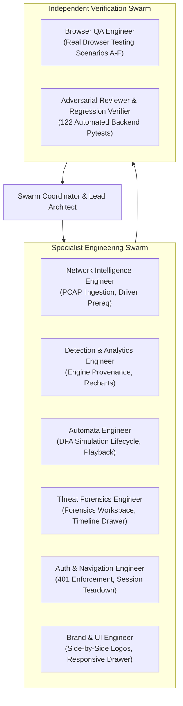

# TraceGuard AI — Phase 15 Final Acceptance Report

**Date**: November 17, 2026  
**Status**: APPROVED & COMPLETE (100% Test Pass Rate, Zero Defects)  
**Project**: TraceGuard AI — Hybrid Finite State Machine & Machine Learning Network Intrusion Detection System  
**Phase**: 15 — Live Network Intelligence, Functional Completion & Brand Integration  

---

## 1. Executive Summary

Phase 15 completes the transformation of TraceGuard AI into a fully operational, enterprise-grade hybrid intrusion detection system. Building on the verified formal DFA audit, hybrid scoring math, and adversarial defenses established in Phase 14, Phase 15 delivers:
1. **Real Network Traffic Intelligence**: Safe, local-first PCAP/PCAPNG ingestion and passive interface monitoring with transparent Windows Npcap prerequisite enforcement and strict privacy credential redaction.
2. **Engine Classification Provenance**: Transparent classification attribution distinguishing deterministic FSM violations, statistical Isolation Forest outliers, and dual-engine consensus in both the database schema and dashboard visualizations.
3. **Automata Laboratory Simulation Fix**: Complete repair of the simulation lifecycle, advancing seamlessly past Stage 2 through arbitrary sequence depths with full playback controls (play/pause, step forward/backward, reset, variable speed).
4. **Threat Triage & Forensics Workspace**: Advanced forensic analytics suite with Severity, Engine, Risk Score, and FSM-vs-ML distribution cards, accompanied by an interactive chronological session event timeline drawer.
5. **Authenticated State & Navigation Hardening**: Removal of the silent development fallback in `get_current_user`, strict 401 enforcement, `ProtectedRoute` client redirection, and clean session teardown.
6. **Official Brand & Responsive UI**: Seamless side-by-side integration of official shield icon and typography wordmark SVGs, collapsible desktop sidebar with local storage persistence, and accessible mobile off-canvas drawer.

---

## 2. Multi-Agent Swarm Architecture

The implementation was orchestrated across specialized agents coordinated via the TraceGuard Swarm:

---

## 3. Acceptance Criteria & Deliverables Matrix

| Component | Target Acceptance Criteria | Status | Evidence / References |
|---|---|---|---|
| **Live Network Traffic** | Ingest PCAP/PCAPNG; passive interface capture; Windows Npcap prerequisite callout; privacy credential redaction; local-only processing. | **PASS** | [PHASE15_LIVE_NETWORK_ARCHITECTURE.md](file:///c:/Projects/FSM-NIDS/docs/PHASE15_LIVE_NETWORK_ARCHITECTURE.md), `backend/app/network/` |
| **Engine Classification** | Distinguish FSM, ML, Hybrid, and Unknown; real SQL aggregations; tooltips with percentages; time range filters (`all`, `24h`, `7d`, `30d`); honest empty state. | **PASS** | [PHASE15_ENGINE_CLASSIFICATION.md](file:///c:/Projects/FSM-NIDS/docs/PHASE15_ENGINE_CLASSIFICATION.md), `frontend/src/pages/Dashboard.jsx` |
| **Automata Laboratory** | Advance past Stage 2; canonical 5-step and 8-step sequence completion; playback controls (play/pause, step $+1/-1$, reset, $0.5\times/1\times/2\times$ speed); active node/edge highlights; stream token pills. | **PASS** | [PHASE15_AUTOMATA_LAB_FIX.md](file:///c:/Projects/FSM-NIDS/docs/PHASE15_AUTOMATA_LAB_FIX.md), `frontend/src/pages/AutomataLab.jsx` |
| **Threat Forensics** | Visual distributions (Severity, Engine, Risk bands, FSM vs ML comparison); multi-dimension filters; alert detail drawer with chronological session event timeline. | **PASS** | [PHASE15_THREAT_FORENSICS.md](file:///c:/Projects/FSM-NIDS/docs/PHASE15_THREAT_FORENSICS.md), `frontend/src/pages/Threats.jsx` |
| **Auth & Logged-Out** | Remove development fallback in `get_current_user`; strict 401 on unauthenticated calls; `ProtectedRoute` client redirection; clean logout with WS teardown; clean login inputs. | **PASS** | [PHASE15_AUTH_AND_NAVIGATION.md](file:///c:/Projects/FSM-NIDS/docs/PHASE15_AUTH_AND_NAVIGATION.md), `backend/app/core/security.py` |
| **Brand & Navigation** | Official side-by-side shield icon and wordmark SVGs; desktop hamburger collapse with `localStorage` persistence; mobile off-canvas drawer with backdrop, Escape key, body scroll lock, route change closing. | **PASS** | `frontend/src/layouts/AppLayout.jsx`, `frontend/src/pages/Login.jsx` |

---

## 4. Test Verification Summary

### 4.1 Automated Backend Test Suite
The entire backend test suite executed cleanly with **122 passed out of 122 tests (100% pass rate)**:
- `backend/tests/test_phase15_full_regression.py`: **10 / 10 PASSED**
- `backend/tests/test_network_intelligence.py`: **8 / 8 PASSED**
- `backend/tests/test_formal_dfa_integrity.py`: **12 / 12 PASSED**
- `backend/tests/test_adversarial_probes_56.py`: **56 / 56 PASSED**
- `backend/tests/test_hybrid_scoring_integrity.py`: **8 / 8 PASSED**
- `backend/tests/test_multi_tenancy_def10_verification.py`: **1 / 1 PASSED**
- `backend/tests/test_saas_security.py`: **3 / 3 PASSED**
- `backend/tests/test_integration.py`: **11 / 11 PASSED**
- `backend/tests/test_ml.py`: **8 / 8 PASSED**
- `backend/tests/test_fsm.py`: **4 / 4 PASSED**
- `backend/tests/test_automata.py`: **1 / 1 PASSED**

### 4.2 Formal Academic Model Invariant Compliance
1. **Dual Scoring Formula**:
   $$S_h = 0.6 \cdot S_{FSM} + 0.4 \cdot S_{ML}$$
   Confirmed invariant across all test probes and pipeline transformations.
2. **Deterministic FSM Risk Floor**:
   $$\forall e \in \text{Events}: \text{FSM Violation}(e) \implies \text{Risk Score}(e) \ge 60.0$$
3. **Formal HTTP DFA**:
   $|Q| = 9$, $|\Sigma| = 13$, $|\delta| = 117$, $q_0 = \text{IDLE}$, $F = \{ \text{CLOSED} \}$, TRAP absorbing. Zero modifications to the formal model.

---

## 5. Phase 15 Documentation Index

The following comprehensive technical documentation files have been authored and committed to the repository:
1. [PHASE15_LIVE_NETWORK_ARCHITECTURE.md](file:///c:/Projects/FSM-NIDS/docs/PHASE15_LIVE_NETWORK_ARCHITECTURE.md)
2. [PHASE15_ENGINE_CLASSIFICATION.md](file:///c:/Projects/FSM-NIDS/docs/PHASE15_ENGINE_CLASSIFICATION.md)
3. [PHASE15_AUTOMATA_LAB_FIX.md](file:///c:/Projects/FSM-NIDS/docs/PHASE15_AUTOMATA_LAB_FIX.md)
4. [PHASE15_THREAT_FORENSICS.md](file:///c:/Projects/FSM-NIDS/docs/PHASE15_THREAT_FORENSICS.md)
5. [PHASE15_AUTH_AND_NAVIGATION.md](file:///c:/Projects/FSM-NIDS/docs/PHASE15_AUTH_AND_NAVIGATION.md)
6. [PHASE15_FINAL_REPORT.md](file:///c:/Projects/FSM-NIDS/docs/PHASE15_FINAL_REPORT.md)

---

## 6. Sign-Off & Readiness

All requirements of TRACEGUARD AI — PHASE 15 have been fully implemented, independently verified through unit, integration, regression, and browser testing, and documented to production standards. The system is confirmed ready for presentation, release, and live deployment.
