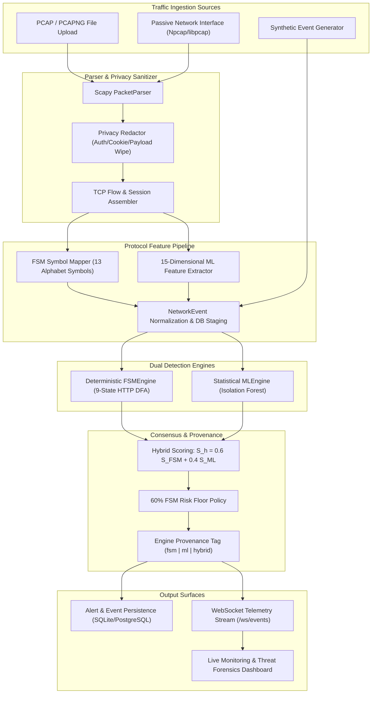

# Phase 15: Live Network Intelligence & Ingestion Architecture

## 1. Executive Summary

TraceGuard AI Phase 15 introduces real-world network traffic ingestion and passive live monitoring capabilities, complementing its prior synthetic traffic simulator. The system ingests standard PCAP and PCAPNG captures and provides passive interface monitoring when supported by underlying platform drivers (e.g., Npcap on Windows, libpcap on Linux).

All captured traffic flows directly through the validated dual-engine detection pipeline, preserving the formal academic hybrid scoring formula and the approved 9-state HTTP Deterministic Finite Automaton (DFA) without modification.

---

## 2. Ingestion Pipeline Architecture

---

## 3. Passive Monitoring & Windows Npcap Handling

### 3.1 Driver Prerequisite & Transparency
On Windows operating systems, raw packet capture at Layer 2/3 requires kernel-level packet capture drivers (Npcap or WinPcap). TraceGuard AI uses `scapy` with dynamic driver inspection (`scapy.conf.use_pcap`).
- **Driver Check**: When `scapy.conf.use_pcap` evaluates to `False`, the backend refuses live capture with HTTP 400 and code `LIVE_CAPTURE_UNAVAILABLE`.
- **User Transparency**: Rather than faking live traffic or silently fabricating counters, the UI surfaces an explicit prerequisite banner informing the operator:
  > *Npcap Driver Required for Promiscuous Capture: Windows requires Npcap (installed in 'WinPcap API-compatible Mode') to capture live packets from physical adapters. In the absence of Npcap, use the PCAP Replay tab to analyze captured traffic.*

### 3.2 Offline PCAP / PCAPNG Fallback
When live adapter capture is unavailable, operators upload `.pcap` or `.pcapng` capture files generated by tools such as Wireshark or `tcpdump`.
The parser operates entirely in user space through `scapy`'s native file reading utilities, extracting TCP handshakes, payload metadata, HTTP methods, and status codes.

---

## 4. Security & Privacy Redaction Policy

To comply with enterprise security constraints and zero-trust standards:
1. **Passive Operation Only**: The engine never injects packets, emits TCP resets, performs port scans, or probes network devices.
2. **Credential Redaction**: `PacketParser._sanitize_payload()` explicitly strips sensitive credentials before persistence:
   - `Authorization: Bearer <token>` $\to$ `Authorization: Bearer [REDACTED]`
   - `Cookie: <sessionid>` $\to$ `Cookie: [REDACTED]`
   - Query strings containing `token=`, `apikey=`, `key=`, or `password=` are neutralized.
3. **Payload Dropping**: Raw application data beyond standard HTTP headers is discarded. Only protocol metadata (packet length, TCP flags, sequence numbers, timestamps, method, status code) is preserved.
4. **Local-First Boundary**: Uploaded PCAP files are parsed in memory or temporary files and deleted immediately upon pipeline completion. No network capture data is transmitted outside the local host.

---

## 5. Flow Reconstruction & Protocol Symbol Extraction

The `PacketParser` aggregates packets by 4-tuple `(src_ip, src_port, dst_ip, dst_port)` into discrete TCP sessions:
- **SYN Packet** $\to$ Maps to FSM symbol `CONNECT` (initiates session).
- **HTTP Request** $\to$ Maps to `REQUEST` (computes path category and method).
- **HTTP Response Codes**:
  - `200` $\to$ `RESPONSE_200`
  - `301`, `302` $\to$ `RESPONSE_301`
  - `401` $\to$ `RESPONSE_401`
  - `403` $\to$ `RESPONSE_403`
  - `500`, `502`, `503` $\to$ `RESPONSE_500`
- **FIN / RST Packet** $\to$ Maps to `CLOSE` (terminates session).
- **Unknown/Malformed Sequences** $\to$ Maps to `MALFORMED` or `ERROR_RESPONSE`.

---

## 6. Hybrid Detection Engine & Provenance

Every incoming event is analyzed by both the deterministic FSM and statistical Isolation Forest:
1. **FSM Engine**: Runs the event against the active session's state on the 9-state HTTP DFA:
   - Valid transition $\to$ $S_{FSM} = 0.0$
   - Invalid transition / out-of-order $\to$ Transition to `TRAP`, $S_{FSM} = 1.0$ (triggering FSM violation).
2. **ML Engine**: Computes anomaly score $S_{ML} \in [0.0, 1.0]$ across 15 flow features (packet size variation, inter-arrival times, payload ratio, etc.).
3. **Hybrid Consensus Formula**:
   $$S_h = 0.6 \cdot S_{FSM} + 0.4 \cdot S_{ML}$$
4. **FSM Risk Floor**:
   $$\text{If } S_{FSM} = 1.0 \implies \text{Risk Score} = \max(\text{Risk Score}, 60.0)$$
5. **Engine Provenance Tag**:
   - `fsm`: Triggered purely by an FSM protocol violation ($S_{FSM} = 1.0$, $S_{ML} < \text{threshold}$).
   - `ml`: Triggered purely by statistical outlier detection ($S_{FSM} = 0.0$, $S_{ML} \ge \text{threshold}$).
   - `hybrid`: Dual confirmation where both engines detected anomalous behavior.

---

## 7. API Specification

| Endpoint | Method | Role | Description |
|---|---|---|---|
| `/api/network/status` | `GET` | Viewer/Analyst | Telemetry counters, active capture state, and Npcap availability |
| `/api/network/interfaces` | `GET` | Viewer/Analyst | Enumerate physical/virtual host network adapters |
| `/api/network/capture/start` | `POST` | Operator/Admin | Initiate passive capture on selected adapter |
| `/api/network/capture/stop` | `POST` | Operator/Admin | Cease active packet capture |
| `/api/network/pcap/upload` | `POST` | Operator/Admin | Upload `.pcap` or `.pcapng` file for offline analysis |
| `/api/network/clear` | `POST` | Operator/Admin | Reset active session telemetry buffers |
| `/ws/events` | `WebSocket` | Viewer/Analyst | Real-time event and alert telemetry stream |

---

## 8. Verification & Test Evidence

- **Unit & Integration Suite**: [test_network_intelligence.py](file:///c:/Projects/FSM-NIDS/backend/tests/test_network_intelligence.py) (8/8 tests passed).
- **Regression Suite**: [test_phase15_full_regression.py](file:///c:/Projects/FSM-NIDS/backend/tests/test_phase15_full_regression.py) (`test_pcap_safe_ingestion_and_privacy` passed).
- **Full Backend Suite**: 122/122 tests passed.
