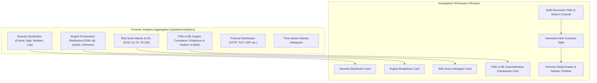

# Phase 15: Threat Triage & Forensics Visual Analytics

## 1. Executive Summary

In Phase 15, the Threat Triage & Forensics interface was upgraded from a static alert listing table into a visual cyber-investigation workspace. SecOps analysts can now visualize threat distributions, correlate deterministic FSM violations with statistical ML anomalies, filter across multiple dimensions, and inspect the exact chronological event sequence of any suspicious network session.

---

## 2. Forensic Visualizations Architecture

---

## 3. Analytical Distribution Cards

The workspace features 4 analytical distribution cards at the top of the interface:

### 3.1 Severity Distribution
- Breaks down alerts into `Critical`, `High`, `Medium`, and `Low`.
- Features proportional progress bars with standardized threat severity badges:
  - Critical: Crimson / Red (`#ef4444`)
  - High: Orange (`#f97316`)
  - Medium: Amber / Yellow (`#eab308`)
  - Low: Emerald / Green (`#10b981`)

### 3.2 Detection Engine Provenance
- Displays exact counts and percentage shares for `FSM`, `ML`, and `Hybrid`.
- Visualizes engine attribution with distinct cyber-defense color indicators.

### 3.3 Risk Score Distribution Bands
- Quantizes alert risk scores ($R \in [0, 100]$) into four forensic risk bands:
  - `0 - 25`: Low Risk (Minor statistical fluctuations)
  - `26 - 50`: Medium Risk (Borderline anomalies)
  - `51 - 75`: High Risk (Definite protocol deviations)
  - `76 - 100`: Critical Risk (Confirmed violations with FSM risk floor or consensus)

### 3.4 FSM vs ML Engine Comparison
- Highlights the intersection between deterministic and statistical detection paradigms:
  - **FSM Protocol Violations**: Violations of the 9-state HTTP DFA.
  - **ML Statistical Outliers**: Isolation Forest feature anomalies without state transition breaks.
  - **Dual Engine Consensus**: Overlapping events detected by both engines simultaneously.

---

## 4. Chronological Session Event Timeline Drawer

When an analyst clicks an alert row, a slide-out Forensic Detail Drawer opens displaying:
1. **Alert Overview**: Alert ID, Session ID, Timestamp, Engine provenance, Severity, Risk score, and Prediction summary.
2. **Deterministic & Statistical Metrics**:
   - FSM violation status and violating transition symbol.
   - Isolation Forest anomaly score and feature weights.
3. **Chronological Session Event Timeline**:
   - Fetches the ordered sequence of `NetworkEvent` records sharing the alert's `session_id`.
   - Displays each network packet/event in order of occurrence ($T_1 \to T_2 \to \dots \to T_k$).
   - Highlights the responsible event that triggered the alert with a distinct accent marker.
   - Allows investigators to trace the packet progression (e.g., `CONNECT` at $T_0$, `REQUEST` at $T_1$, invalid `RESPONSE_200` at $T_2$).

---

## 5. Verification & Test Evidence

- **Backend Analytics Endpoint**: `test_threat_forensics_analytics_endpoint` in [test_phase15_full_regression.py](file:///c:/Projects/FSM-NIDS/backend/tests/test_phase15_full_regression.py) verifies all distributions reconcile (PASSED).
- **Session Timeline Reconstruction**: `test_alert_detail_chronological_timeline` validates chronological event sequencing in alert detail responses (PASSED).
